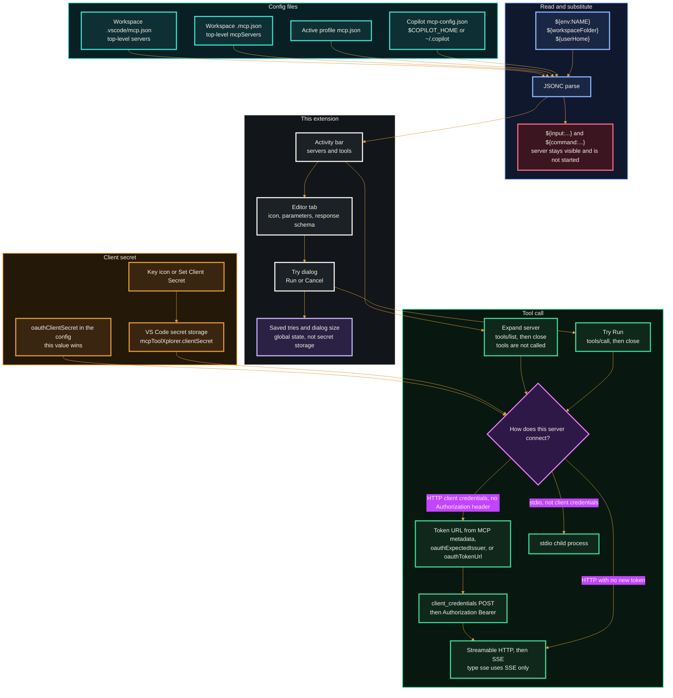

# AGENTS.md

MCP Tool Xplorer is a local VS Code extension. It lists tools from MCP servers you already configured, shows each tool's icon and schemas, and calls a tool only when you choose Try.

Read this before you change the repo. The extension id is `Garrard.mcp-tool-xplorer`. The package name is `mcp-tool-xplorer`. The publisher id is `Garrard`. The current version is `0.1.17`.

## Rules for every change

- Write commit messages as [Conventional Commits](https://www.conventionalcommits.org/). The subject is a type, a colon, and a short line, for example `feat:`, `fix:`, or `docs:`. Follow it with a blank line and a short body of what changed.
- Every commit updates [CHANGELOG.md](CHANGELOG.md) in that same commit. Add the note under `## [Unreleased]`. A change a person using the extension can see goes under Added, Changed, or Fixed. Any other commit still gets one line, so the changelog matches the history.
- A user-facing change also updates [README.md](README.md) in that same commit.
- Do not commit `.vscode/mcp.json`, client secrets, tokens, authorization headers, `node_modules/`, `dist/`, or `*.vsix`.
- Do not log a client secret, copy it into the webview, or put it in the README, the changelog, or an issue.
- Do not weaken the detail-view content security policy. It stays `default-src 'none'` with nonce style and script sources only.
- Run `npm test` before you commit code. `npx tsc --noEmit` checks `src/`. Tests are run with `tsx` and are not part of that `tsc` project.

## Commands

```bash
npm install
npm test
npm run compile
npm run package
```

`npm test` runs `node --import tsx --test tests/*.test.ts`. `npm run compile` bundles `src/extension.ts` to `dist/extension.js`. Press F5 for an Extension Development Host. Install a built package with `code --install-extension mcp-tool-xplorer-<version>.vsix --force`, then reload the window.

## Layout

```text
.
├── src/                              extension source
│   ├── extension.ts                  activate, commands, secret prompt
│   ├── catalog.ts                    load servers, cache tool lists and icons
│   ├── types.ts                      shared server, tool, and credential types
│   ├── config/                       where MCP config is found and read
│   │   ├── origins.ts                which mcp.json files are read
│   │   ├── load.ts                   read those files
│   │   ├── parse.ts                  JSONC, one server entry, OAuth fields
│   │   ├── variables.ts              ${env:NAME}, ${workspaceFolder}, ${userHome}
│   │   └── envFile.ts                envFile values, then env overrides
│   ├── mcp/                          connect, list, call, then close
│   │   ├── session.ts                tools/list and tools/call
│   │   ├── token.ts                  client-credentials token request
│   │   ├── credentials.ts            secret-storage key and redaction
│   │   ├── result.ts                 text, structured content, and a length cap
│   │   └── icons.ts                  pick and cache a tool icon
│   ├── schema/
│   │   └── fields.ts                 parameter and response rows
│   ├── try/                          the parameter dialog
│   │   ├── parameters.ts             dialog fields and coercion
│   │   └── history.ts                saved tries and dialog size
│   └── view/                         activity bar, editor tab, and dialog
│       ├── tree.ts                   activity-bar tree
│       ├── detail.ts                 editor tab and the try dialog
│       ├── html.ts                   detail webview, CSP, and dialog markup
│       ├── open.ts                   single click replaces, double click pins
│       └── svg.ts                    inline a safe SVG icon
├── tests/                            node:test files, one area each
├── media/                            icons shipped with the extension
│   ├── mcp-tools.svg                 activity-bar mark
│   ├── icon.png                      Extensions view, 128 pixels
│   └── logo.png                      README and extension details, 256 pixels
├── .github/                          pull request and issue templates
├── esbuild.js                        bundle src/extension.ts to dist/extension.js
└── package.json                      name, version, commands, and dependencies
```

`esbuild.js` bundles to CommonJS. `vscode` stays external. `mainFields` is `["module", "main"]` so `jsonc-parser` uses its ESM build. The UMD build breaks once it is bundled.

Commands use the `mcpToolXplorer` prefix. The tree node type is `ExplorerNode`. The webview type is `mcpToolXplorer.detail`. The view id is `mcpToolXplorer.tools`.

## Dependencies

Runtime, from `package.json`:

| Package | Locked | Why it is here |
| --- | --- | --- |
| `@modelcontextprotocol/sdk` | 1.32.2 | `Client`, stdio, Streamable HTTP, SSE, and OAuth metadata discovery |
| `jsonc-parser` | 3.3.1 | MCP config files are JSON with comments |

`vscode` is provided by the editor. It is not an npm dependency of the bundle.

Development:

| Package | Locked | Why it is here |
| --- | --- | --- |
| `typescript` | 5.9.3 | `npx tsc --noEmit` |
| `esbuild` | 0.25.12 | bundle `dist/extension.js` |
| `tsx` | 4.23.15 | run the tests as TypeScript |
| `@types/node` | 22 | Node types |
| `@types/vscode` | 1.95 | VS Code API types. The engine is `^1.95.0` |
| `@vscode/vsce` | 3.9.2 | `npm run package` |

Node.js 20 or newer. The MCP client identity in `src/mcp/session.ts` is `{ name: "mcp-tool-xplorer", version }` and must match `package.json`.

## Core flow

Config is read from four places. A client secret comes from the config file when `oauthClientSecret` is set, including `${env:NAME}`. Otherwise it comes from VS Code secret storage, after the key icon or **Set Client Secret**. An `Authorization` header already in the config is sent as written and the client-credentials grant is not used.

Expanding a server connects, follows `tools/list` cursors, and closes. That path does not call a tool. Try opens a new session, calls that one tool, and closes. Connecting times out after 20 seconds. The call times out after 60 seconds.

Saved try values and the dialog size are in VS Code global state (`mcpToolXplorer.savedTries`, `mcpToolXplorer.tryDialogSize`). They are not in secret storage.



Teal is a config file. Blue is parsing. Red is a server that is shown and not started. Amber is the client secret. Ink is the UI. Violet is local state that is not a secret. Green is the MCP session. Magenta is the choice between a token request and a direct connection.

A few rules that are easy to get wrong:

- Stdio plus `oauthGrantType: "client_credentials"` is skipped. The grant is for HTTP.
- The token URL is discovered metadata, then `oauthExpectedIssuer`, then `oauthTokenUrl`. The extension does not POST to the MCP host's `/token` when that host published no metadata.
- If the token endpoint rejects the RFC 8707 `resource` parameter, the request is sent once more without it.
- Browser OAuth is not started. `unix://` and `pipe://` are not opened.
- Try calls the tool without listing first, so the SDK does not validate the result against a cached output schema. The raw result is what the tab shows.
- The detail webview escapes `<` in the saved-try JSON and does not use inline event handlers or `style` attributes.

## Also read

- [README.md](README.md) for what a person using the extension can do
- [PUBLISH-TO-MARKETPLACE.md](PUBLISH-TO-MARKETPLACE.md) for the Visual Studio Marketplace and Open VSX
- [CONTRIBUTING.md](CONTRIBUTING.md) for issues and pull requests
- [SECURITY.md](SECURITY.md) for secrets and how to report a vulnerability
- [CHANGELOG.md](CHANGELOG.md) for what has shipped
